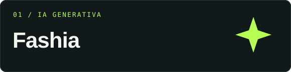
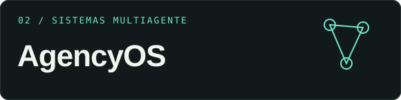

<picture>
  <source media="(max-width: 640px)" srcset="assets/hero-mobile.svg">
  
</picture>

  <a href="#sobre-mí">Sobre mí</a> &nbsp; · &nbsp;
  <a href="#proyectos-destacados">Proyectos</a> &nbsp; · &nbsp;
  <a href="#tecnologías">Tecnologías</a>

### Sobre mí

Me enfoco en **inteligencia artificial aplicada, agentes y automatización**. Desarrollo aplicaciones web y exploro cómo conectar modelos, datos e interfaces para crear herramientas útiles.

- **IA aplicada:** experiencias y productos con inteligencia artificial generativa.
- **Agentes:** coordinación de procesos y herramientas en sistemas multiagente.
- **Automatización:** integraciones que conectan aplicaciones y flujos de trabajo.

### Proyectos destacados

<table>
  <tr>
    <td width="50%" valign="top">
      
      
Plataforma de IA generativa para transformar fotografías de productos de moda en contenido editorial.

      
Next.js · TypeScript · Supabase · Gemini

      <a href="https://github.com/RobertAnthonyQ/fashia_platform"><strong>Explorar proyecto ↗</strong></a>
    </td>
    <td width="50%" valign="top">
      
      
Oficina virtual para visualizar y coordinar agentes de IA con sesiones persistentes y comunicación en tiempo real.

      
Next.js · React · Node.js · Socket.io

      <a href="https://github.com/RobertAnthonyQ/office_virtual"><strong>Explorar proyecto ↗</strong></a>
    </td>
  </tr>
  <tr>
    <td width="50%" valign="top">
      
      
Integración de WhatsApp y Chatwoot con Evolution API para conectar conversaciones y flujos de atención.

      
Python · Evolution API · Chatwoot · Docker

      <a href="https://github.com/RobertAnthonyQ/HULTIE"><strong>Explorar proyecto ↗</strong></a>
    </td>
    <td width="50%" valign="top">
      
      
Visualizador interactivo de grafos en 3D para explorar nodos, relaciones y conexiones de Neo4j.

      
Three.js · Neo4j · JavaScript · Python

      <a href="https://github.com/RobertAnthonyQ/Brainlive"><strong>Explorar proyecto ↗</strong></a>
    </td>
  </tr>
</table>

### Tecnologías

   &nbsp;
   &nbsp;
   &nbsp;
   &nbsp;
   &nbsp;
   &nbsp;
   &nbsp;
   &nbsp;
   &nbsp;
  

**Desarrollo:** Python, TypeScript, JavaScript, React, Next.js y Node.js.  
**Datos e integraciones:** Supabase, Neo4j, Docker, Evolution API y Chatwoot.

---

  <strong>Ideas → código → soluciones.</strong> 
  IA aplicada · Agentes · Automatización  
  <a href="https://github.com/RobertAnthonyQ?tab=repositories">Ver todos mis repositorios ↗</a>

