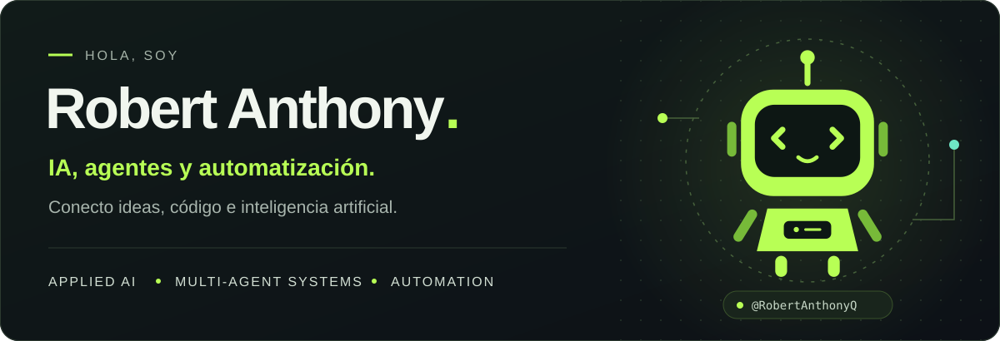

<picture>
  <source media="(max-width: 640px)" srcset="assets/hero-mobile.svg">
  
</picture>

  <a href="#sobre-mí">Sobre mí</a> &nbsp; · &nbsp;
  <a href="#tecnologías">Tecnologías</a>

### Sobre mí

Me enfoco en **inteligencia artificial aplicada, agentes y automatización**. Desarrollo aplicaciones web y exploro cómo conectar modelos, datos e interfaces para crear herramientas útiles.

- **IA aplicada:** experiencias y productos con inteligencia artificial generativa.
- **Agentes:** coordinación de procesos y herramientas en sistemas multiagente.
- **Automatización:** integraciones que conectan aplicaciones y flujos de trabajo.

### Tecnologías

   &nbsp;
   &nbsp;
   &nbsp;
   &nbsp;
   &nbsp;
   &nbsp;
   &nbsp;
   &nbsp;
   &nbsp;
  

**Desarrollo:** Python, TypeScript, JavaScript, React, Next.js y Node.js.  
**Datos e integraciones:** Supabase, Neo4j, Docker, Evolution API y Chatwoot.

---

  <strong>Ideas → código → soluciones.</strong> 
  IA aplicada · Agentes · Automatización

